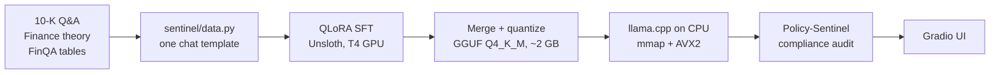

# 🛡️ FinTune-Sentinel: a 3B financial analyst LLM that runs on a laptop CPU

[](https://github.com/Prakruthi19/fintune-sentinel/actions/workflows/tests.yml)

> Llama 3.2 3B fine-tuned on SEC 10-K and FinQA data, quantized to 4-bit GGUF, served on CPU with `llama.cpp`, and every answer checked by a compliance layer before the user sees it.

**Live demo:** _coming soon (Hugging Face Space)_

---

## Why

General-purpose LLMs answering questions about 10-K filings tend to (1) do arithmetic loosely, (2) drop units ("revenue grew 1.133"), and (3) drift into investment advice, which is a liability for any regulated firm. FinTune-Sentinel targets all three on hardware an analyst already has: no GPU at inference time.

## Architecture



| Component | What it does | Code |
| :--- | :--- | :--- |
| Data pipeline | Converts three datasets into one chat format; renders FinQA tables as markdown and its gold calculation program as step-by-step targets | `sentinel/data.py` |
| Training | QLoRA (r=32) on all attention + MLP projections, loss on assistant tokens only, held-out eval split, GGUF export | `scripts/train_sft.py` |
| Inference | `llama-cpp-python`, 4-bit Q4_K_M weights, model's own Llama-3 chat template | `app.py` |
| Policy-Sentinel | Redacts trade recommendations; flags financial figures with no unit | `sentinel/governance.py` |
| Evaluation | FinQA execution accuracy, unit compliance, trade-advice rate, CPU latency and tokens/sec | `scripts/evaluate.py` |
| Quantization explainer | From-scratch Q4_0 and NF4 quantizers plus a GGUF header writer/reader | `scripts/quant_demo.py` |

## Results

Measured with `scripts/evaluate.py` on the held-out FinQA test set (CPU only, `llama.cpp`, temperature 0).

| Model | FinQA exec. accuracy | Answers with unit-less figures | Trade-advice rate | Median latency | Gen tok/s |
| :--- | :--- | :--- | :--- | :--- | :--- |
| Llama 3.2 3B Instruct (base, Q4_K_M) | _pending_ | | | | |
| Sentinel v1 (Q4_K_M) | _pending_ | | | | |
| Sentinel v2 (Q4_K_M) | _pending_ | | | | |

Hardware: _to be filled in_.

## Policy-Sentinel

Every response passes through `audit()` before it is shown:

1. **Trade advice → `REJECTED`.** Phrase-level patterns ("strong buy rating", "I recommend selling", "price target") are redacted and a disclaimer is appended. Accounting vocabulary such as *selling, general & administrative*, *shareholders* and *buyback* is deliberately not matched (the v1 substring check flagged all of them).
2. **Unit-less figures → `FLAGGED`.** Decimals and values ≥ 100 with no `$`, `%`, or scale word are reported; years, list numbers and labels like "Item 1A" are ignored.
3. Otherwise **`APPROVED`.** The status is shown under every answer.

## What I learned building v2

Auditing the v1 training run turned up real bugs. Fixing them was most of the work:

- **Questions and answers were swapped** for the finance-theory dataset: the parser put the answer in the user turn and left the assistant turn empty.
- **Leaked Llama-2 tokens:** `</s>` was left inside training targets, so the fine-tuned model printed a literal `</s>`.
- **Truncation cut off answers:** long 10-K contexts were truncated from the end, removing the very text the model was supposed to learn. v2 drops over-length examples instead.
- **Loss was dominated by the prompt:** v2 masks system and user tokens so only the analyst's answer is learned.
- **FinQA had no reasoning targets:** v2 turns the gold program (`subtract(510, 450), divide(#0, 450)`) into numbered calculation steps, and keeps dev/test out of training.
- **Duplicate BOS / hand-built prompts:** training and inference now share the tokenizer's chat template.
- **Eyeball evaluation:** three hand-picked prompts were replaced by a scored benchmark.

## Limitations

- Policy-Sentinel is rule-based (regex), not a learned classifier: it is transparent and fast, but paraphrased advice can slip through.
- The unit check does not verify that a number is *correct* or present in the source filing; grounding against the provided context is the next planned check.
- 3B parameters limit multi-step reasoning on long tables; the model is an analyst's assistant, not a replacement.

## Training data

1. [Financial Q&A-10k](https://www.kaggle.com/datasets/yousefsaeedian/financial-q-and-a-10k): questions grounded in 10-K passages.
2. [Finance-Llama2-1k](https://www.kaggle.com/datasets/yousefsaeedian/finance-llama2-1k): finance concepts (YTM, D/E, hedging).
3. [FinQA](https://www.kaggle.com/datasets/visalakshiiyer/question-answering-financial-data): numerical reasoning over filing tables, with gold calculation programs.

## Quick start

Requires Python 3.10–3.12 (prebuilt CPU wheels for `llama-cpp-python`).

```bash
git clone https://github.com/Prakruthi19/fintune-sentinel.git
cd fintune-sentinel
pip install -r requirements.txt
python app.py            # downloads the GGUF (~2 GB) and opens http://localhost:7860
```

Docker:

```bash
docker build -t sentinel . && docker run -p 8080:8080 sentinel
```

Other entry points:

```bash
python -m pytest -q                                   # unit tests (no model needed)
python scripts/quant_demo.py                          # quantization walkthrough
python -m scripts.evaluate --finqa data/test.json --n 100 --model v1=models/sentinel-v1.Q4_K_M.gguf
python -m scripts.train_sft --load-in-4bit --out runs/v2   # GPU; see notebooks/train_v2_kaggle.ipynb
```
